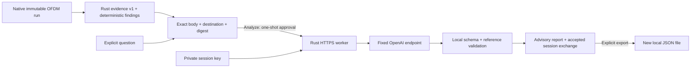

# AI Assistance implementation

[Developer index](README.md) · [User guide](../ui/ai-assistance.md)

Optional, read-only OpenAI review of native OFDM Profile Performance runs.
Core parsers and MERLIN are unchanged. Credentials are session-only and private
in Rust, with best-effort `zeroize` cleanup; Qt/FFI temporary copies mean complete
memory erasure and protection from process dumps cannot be promised.
The native setup popup supports masked manual entry and explicit bounded `.txt`/
`.key` import (4096 ASCII graphic bytes, optional final LF/CRLF). No automatic
key-file loading, key-path retention, environment-key lookup or plaintext writes.

The CXX-Qt 0.7.3 generator requires registered bridge declarations to share one
directory (QTBUG-93443). Keep the thin bridge in `apps/qt/src/ai.rs` and its
implementation in `apps/qt/src/ai/session.rs`.

## OpenAI OFDM review implementation

The current extension
adds one active OpenAI adapter; other providers remain setup-only. No SDK, new
host package or dependency was added. The existing pinned ureq/TLS and sha2 owners
supply transport and digests; MERLIN remains untouched.

| Owner | Current responsibility |
| --- | --- |
| `simulation/fec/workspace.rs` | Copy resolved settings/origins from MERLIN; preserve used versus ignored channel state. |
| `simulation/fec/batch.rs` | Attach allowlisted evidence to completed/partial/cancelled native results; retain numerical results when evidence is unavailable. Hash original selected bytes without paths or MAC fields. |
| `ai/evidence.rs` | Closed v1 envelope, exact decimal count strings, immutable run hash, two scope domains, deterministic observed-error/status findings and strict metadata checks. No new DSP/statistics or universal health thresholds. |
| `ai/protocol.rs` | Duplicate-free bounded parsing, exact request freezing, one-shot approval, secret exclusion, structured response/reference validation and locally attached provenance/usage. |
| `ai/transport.rs` | OpenAI metadata GET and approved Chat Completions POST; fixed HTTPS endpoints, redirects disabled, no application retry/fallback. Existing TLS trust remains enabled. |
| `apps/qt/src/ai/session.rs` | Worker lifecycle, GUI-thread completion checks against current generation/source/cancel flag, bounded session log and explicit new-file export. |
| `AiAnalysisDialog.qml` | Question, complete exact-body preview, approval, offline findings, plain-text advisory report and current-run log. No calculations or remote markup execution. |

See [evidence v1 schema](../reference/ai/evidence-v1.schema.json) and
[response v1 schema](../reference/ai/response-v1.schema.json). Tests compare schema
keys and the provider response schema to Rust serialization; typed deserialization,
limits, identity/scopes and reference checks impose additional cross-field rules.
Count values use exact decimal strings; JavaScript never rounds numerical truth.
Findings and numeric provenance are attached locally, never accepted from a model.
A reference resolves only when ID, value, unit, scope and profile match approved
available evidence. Narrative reasoning remains advisory even with valid references.

### Bounds and approval

- Evidence: 64 KiB; outgoing body: 96 KiB; provider envelope: 128 KiB; report: 32 KiB.
- Question: 2048 bytes; report summary: 2048 bytes; 16 claims with up to 16 references;
  12 limitations and 12 checks, each 1024 bytes; maximum JSON depth: 20.
- Non-streamed Chat Completions: at most 4096 completion tokens; model must support
  strict `json_schema`. No tools, attachments, hidden history, auto-repair or fallback.
- Total request timeout 60 seconds; connect 10 seconds; read/write 8 seconds.
  Cooperative cancellation rejects late results and may wait for blocked I/O timeout.
- Pending approval binds frozen body, active credentials/settings and source token;
  every mutation consumes/invalidates it, even if values are restored. The worker
  sends the stored UTF-8 body directly via `send_bytes`, not a rebuilt JSON object.
- Only one network worker at a time. Busy stays set until acknowledgement. Completion
  rechecks cancellation on Qt's thread, including cancellation after worker queuing.
- Errors expose only safe categories, never remote error bodies, headers or keys.
  The selected model's metadata GET is an access probe, not an inference guarantee.
- Session log: last 20 accepted exchanges, reset on source replacement; exports are
  explicit JSON with `create_new`. No automatic persistence or saved-history browser.

The first functional slice does not close all seven delivery stages. OS vaults,
non-OpenAI dispatch, history browsing/import/delete, failed/cancelled-turn records,
context-selected follow-ups, dated token pricing and native installed/live-provider
validation remain open. No live credential or provider request is used in tests.

### Offline native preview capture

After building, use the existing OFDM smoke harness with `--ai-preview-only` and
one profile. It runs the fixture-backed decoder, configures a synthetic in-memory
key, exercises the actual Rust preview adapter, captures both themes, invalidates
approval on close and exits with `AI_PREVIEW_OK`. It never calls Analyze or Test
connection. Set the output prefix under a temporary directory for verification;
use `docs/ui/images/ai/ofdm` only when intentionally refreshing documentation.

Reviewed OpenAI contracts: [model metadata](https://developers.openai.com/api/reference/resources/models/methods/retrieve),
[Chat Completions](https://developers.openai.com/api/reference/resources/chat/subresources/completions/methods/create)
and [structured outputs](https://developers.openai.com/api/docs/guides/structured-outputs).
No compatibility claim is made for models that reject these options.

### Local acceptance record — 2026-11-17

Passed 210 workspace Rust tests, 172 QML tests, five Qt adapter tests, workspace
and Qt warnings-denied Clippy, formatting, SW-QA hygiene, native Qt build and
whitespace/link/schema/baseline checks. `AI_SETUP_OK` exercises the actual setup
bridge; `AI_PREVIEW_OK` uses the native fixture-backed OFDM/MCE decoder and the
popup's actual Preview action, then verifies approval invalidation on close.
Refreshed setup, OFDM workspace and exact-request screenshots in dark/light.
Only synthetic in-memory keys and mocked provider responses were used. No real
credential, live AI request, installed package or Windows/macOS runtime validation,
commit, push or release was performed. These remaining delivery gates stay open.

The ignored-channel regression also verifies that unity mode is used, the state
is explicitly Ignored and the unused channel is excluded from source hashes.

## Credential-free Demo AI

`ai/demo.rs` owns a credential-free `DemoRequest`. It has no transport parameter,
secret field or provider capability. Preview/approval reuse the strict evidence,
question bounds, digest, source identity and single-use lifecycle. A pending mode
bit prevents either approval path from accepting the other mode's request.
Demo output copies existing deterministic findings and exact available references,
then passes the same closed report validator. No scientific calculation, fabricated
usage or language-model answer is introduced. Exports retain explicit demo markers.

`--ai-demo` is supported by the native executable and Qt launcher, including
`--ai-demo --skip-build`. The backend stores a private launch lock; live analysis
and connection testing consult it independently of mutable presentation state.
The normal-session checkbox uses the same dispatch rule. Switching invalidates
approval. Demo selection never creates credentials or contacts a provider; it
never falls back to a live adapter, including on validation failure. Normal GitHub
update checks remain independent. No package or development dependency is added.

Tests cover no-key execution, exact references, null usage, mode-crossing/replay/
cancellation rejection, the backend launch lock, explicit Demo labeling and hidden
credential controls. Native `--ofdm-smoke ... --ai-demo --ai-demo-only` runs real
fixture FEC, previews and executes the local response, checks the session log and
captures both themes. Require `AI_DEMO_OK`; normal live preview uses
`--ai-preview-only` and remains offline with a synthetic key.

### Demo validation

Local validation passed: 212 workspace Rust tests, 174 QML tests and six Qt adapter Rust tests; workspace and Qt Clippy with warnings denied; Bash syntax and ShellCheck; SW-QA hygiene. Native offscreen runs returned `AI_DEMO_OK` and `AI_PREVIEW_OK`. Demo report screenshots were reviewed in dark and light themes. No live AI provider request was made.
