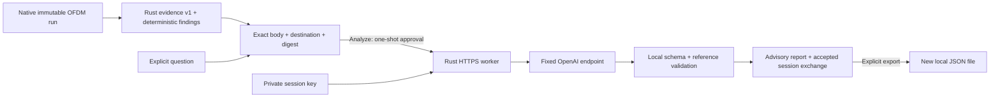
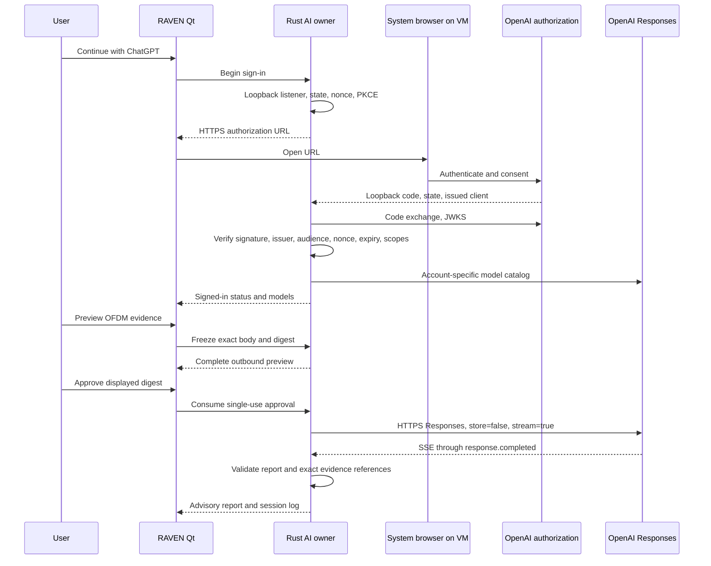

# AI Assistance implementation

[Developer index](README.md) · [User guide](../ui/ai-assistance.md)

Optional, read-only OpenAI review of native OFDM Profile Performance runs.
Core parsers and MERLIN are unchanged. Credentials are session-only and private
in Rust, with best-effort `zeroize` cleanup; Qt/FFI temporary copies mean complete
memory erasure and protection from process dumps cannot be promised.
The native setup popup supports masked manual entry and explicit bounded `.txt`/
`.key` import (4096 ASCII graphic bytes, optional final LF/CRLF). No automatic
key-file loading, key-path retention, environment-key lookup or plaintext writes.

The CXX-Qt 0.7.3 generator requires registered bridge declarations to share one
directory (QTBUG-93443). Keep the thin bridge in `apps/qt/src/ai.rs` and its
implementation in `apps/qt/src/ai/session.rs`.

## OpenAI OFDM review implementation

The current extension
supports OpenAI API-key review and a separate ChatGPT subscription route; other
providers remain setup-only. No SDK or new host package is required. Existing
ureq/TLS and sha2 owners supply transport and digests; pinned ring and base64
are explicit dependencies for RS256 verification, secure randomness and PKCE.
MERLIN remains untouched.

| Owner | Current responsibility |
| --- | --- |
| `simulation/fec/workspace.rs` | Copy resolved settings/origins from MERLIN; preserve used versus ignored channel state. |
| `simulation/fec/batch.rs` | Attach allowlisted evidence to completed/partial/cancelled native results; retain numerical results when evidence is unavailable. Hash original selected bytes without paths or MAC fields. |
| `ai/evidence.rs` | Closed v1 envelope, exact decimal count strings, immutable run hash, two scope domains, deterministic observed-error/status findings and strict metadata checks. No new DSP/statistics or universal health thresholds. |
| `ai/protocol.rs` | Duplicate-free bounded parsing, exact request freezing, one-shot approval, secret exclusion, structured response/reference validation and locally attached provenance/usage. |
| `ai/transport.rs` | OpenAI metadata GET and approved Chat Completions POST; fixed HTTPS endpoints, redirects disabled, no application retry/fallback. Existing TLS trust remains enabled. |
| `apps/qt/src/ai/session.rs` | Worker lifecycle, GUI-thread completion checks against current generation/source/cancel flag, bounded session log and explicit new-file export. |
| `AiAnalysisDialog.qml` | Question, complete exact-body preview, approval, offline findings, plain-text advisory report and current-run log. No calculations or remote markup execution. |



See [evidence v1 schema](../reference/ai/evidence-v1.schema.json) and
[response v1 schema](../reference/ai/response-v1.schema.json). Tests compare schema
keys and the provider response schema to Rust serialization; typed deserialization,
limits, identity/scopes and reference checks impose additional cross-field rules.
Count values use exact decimal strings; JavaScript never rounds numerical truth.
Findings and numeric provenance are attached locally, never accepted from a model.
A reference resolves only when ID, value, unit, scope and profile match approved
available evidence. Narrative reasoning remains advisory even with valid references.

### Bounds and approval

- Evidence: 64 KiB; outgoing body: 96 KiB; provider envelope: 128 KiB; report: 32 KiB.
- Question: 2048 bytes; report summary: 2048 bytes; 16 claims with up to 16 references;
  12 limitations and 12 checks, each 1024 bytes; maximum JSON depth: 20.
- Non-streamed Chat Completions: at most 4096 completion tokens; model must support
  strict `json_schema`. No tools, attachments, hidden history, auto-repair or fallback.
- Total request timeout 60 seconds; connect 10 seconds; read/write 8 seconds.
  Cooperative cancellation rejects late results and may wait for blocked I/O timeout.
- Pending approval binds frozen body, active credentials/settings and source token;
  every mutation consumes/invalidates it, even if values are restored. The worker
  sends the stored UTF-8 body directly via `send_bytes`, not a rebuilt JSON object.
- Only one network worker at a time. Busy stays set until acknowledgement. Completion
  rechecks cancellation on Qt's thread, including cancellation after worker queuing.
- Errors expose only safe categories, never remote error bodies, headers or keys.
  The selected model's metadata GET is an access probe, not an inference guarantee.
- Session log: last 20 accepted exchanges, reset on source replacement; exports are
  explicit JSON with `create_new`. No automatic persistence or saved-history browser.

The first functional slice does not close all seven delivery stages. OS vaults,
non-OpenAI dispatch, history browsing/import/delete, failed/cancelled-turn records,
context-selected follow-ups, dated token pricing and native installed/live-provider
validation remain open. No live credential or provider request is used in tests.

### Offline native preview capture

After building, use the existing OFDM smoke harness with `--ai-preview-only` and
one profile. It runs the fixture-backed decoder, configures a synthetic in-memory
key, exercises the actual Rust preview adapter, captures both themes, invalidates
approval on close and exits with `AI_PREVIEW_OK`. It never calls Analyze or Test
connection. Set the output prefix under a temporary directory for verification;
use `docs/ui/images/ai/ofdm` only when intentionally refreshing documentation.

Reviewed OpenAI contracts: [model metadata](https://developers.openai.com/api/reference/resources/models/methods/retrieve),
[Chat Completions](https://developers.openai.com/api/reference/resources/chat/subresources/completions/methods/create)
and [structured outputs](https://developers.openai.com/api/docs/guides/structured-outputs).
No compatibility claim is made for models that reject these options.


### Local acceptance record — 2026-11-17

Passed 210 workspace Rust tests, 172 QML tests, five Qt adapter tests, workspace
and Qt warnings-denied Clippy, formatting, SW-QA hygiene, native Qt build and
whitespace/link/schema/baseline checks. `AI_SETUP_OK` exercises the actual setup
bridge; `AI_PREVIEW_OK` uses the native fixture-backed OFDM/MCE decoder and the
popup's actual Preview action, then verifies approval invalidation on close.
Refreshed setup, OFDM workspace and exact-request screenshots in dark/light.
Only synthetic in-memory keys and mocked provider responses were used. No real
credential, live AI request, installed package or Windows/macOS runtime validation,
commit, push or release was performed. These remaining delivery gates stay open.

The ignored-channel regression also verifies that unity mode is used, the state
is explicitly Ignored and the unused channel is excluded from source hashes.


## Credential-free Demo AI

`ai/demo.rs` owns a credential-free `DemoRequest`. It has no transport parameter,
secret field or provider capability. Preview/approval reuse the strict evidence,
question bounds, digest, source identity and single-use lifecycle. A pending mode
bit prevents either approval path from accepting the other mode's request.
Demo output copies existing deterministic findings and exact available references,
then passes the same closed report validator. No scientific calculation, fabricated
usage or language-model answer is introduced. Exports retain explicit demo markers.

`--ai-demo` is supported by the native executable and Qt launcher, including
`--ai-demo --skip-build`. The backend stores a private launch lock; live analysis
and connection testing consult it independently of mutable presentation state.
The normal-session checkbox uses the same dispatch rule. Switching invalidates
approval. Demo selection never creates credentials or contacts a provider; it
never falls back to a live adapter, including on validation failure. Normal GitHub
update checks remain independent. No package or development dependency is added.

Tests cover no-key execution, exact references, null usage, mode-crossing/replay/
cancellation rejection, the backend launch lock, explicit Demo labeling and hidden
credential controls. Native `--ofdm-smoke ... --ai-demo --ai-demo-only` runs real
fixture FEC, previews and executes the local response, checks the session log and
captures both themes. Require `AI_DEMO_OK`; normal live preview uses
`--ai-preview-only` and remains offline with a synthetic key.


### Demo validation

Local validation passed: 212 workspace Rust tests, 174 QML tests and six Qt adapter Rust tests; workspace and Qt Clippy with warnings denied; Bash syntax and ShellCheck; SW-QA hygiene. Native offscreen runs returned `AI_DEMO_OK` and `AI_PREVIEW_OK`. Demo report screenshots were reviewed in dark and light themes. No live AI provider request was made.


## ChatGPT browser sign-in architecture

Rust owns the full authentication state. QML receives only the authorization URL,
nonsecret model catalog and sanitized status. `Continue with ChatGPT` opens the
system browser; no password form, embedded browser, Codex token import or arbitrary
provider URL is accepted. Other providers are unchanged.



| Owner | Responsibility |
| --- | --- |
| `ai/chatgpt/login.rs` | Loopback callback, cryptographic random state/nonce/verifier, PKCE, fixed OAuth endpoints, ID-token RS256 verification and nonsecret registration metadata. |
| `ai/chatgpt/mod.rs` | Opaque ephemeral credential ownership, visible-model selection, expiry and remote revocation. |
| `ai/chatgpt/responses.rs` | Bounded SSE terminal-event handling, rejecting interrupted, failed, refused or tool-bearing output. |
| `ai/protocol.rs` | Same evidence schema, exact preview/digest, single-use approval, reference validation and conversation envelope for both OpenAI routes. |
| `apps/qt/src/ai/session.rs` | Cancellable authentication worker; generation checks before credential activation; no token serialization to QML. |

No new scientific calculations are introduced. ChatGPT uses Responses with an
array input, developer instructions, structured text output, `store=false` and
`stream=true`. No tools, fallback billing, automatic repair or inference retries.
Only a terminal completed response can be validated and attached to the run.

Authentication binds a fresh state and nonce to PKCE and the exact ephemeral
`http://127.0.0.1:<port>/auth/callback`. Only the port varies. The browser listener
expires after three minutes; cancellation is polled during accept and reads.
Duplicate callback fields, wrong state/path/client, denial and malformed requests
cannot activate credentials. ID-token validation requires the published OpenAI
RS256 key, issuer, audience, nonce, issued-at and expiry; multi-audience tokens
also require the matching authorized party. Granted scopes must include plan
usage. A visible model is a catalog entry, not proof of successful inference.

Host/client/subject metadata is atomically saved in `chatgpt-registration.json`:
`~/.config/raven/` on Linux, `%APPDATA%/RAVEN/` on Windows and
`~/Library/Application Support/RAVEN/` on macOS. Only one retained registration is
supported initially. Returning sign-in reuses its issued client and requires the
same verified subject. No access, refresh or ID token is persisted. Automatic
refresh and multiple saved-account selection remain future work; access expiry
requires explicit reauthorization. Sign-out clears local secrets before attempting
fixed-endpoint remote revocation, and reports when remote revocation is unconfirmed.
No credentials are read on application startup.

### Requirements and test mapping

| Requirement | Local validation |
| --- | --- |
| Explicit browser action, local-only callback and cancellation | `callback_requires_unique_state_code_and_issued_client`; QML explicit-action test. |
| PKCE and stable host without token files | `sign_in_metadata_is_stable_and_redirects_are_rejected`; callback test. |
| Signed identity, nonce, audience and lifetime | `oidc_requires_signature_issuer_audience_nonce_and_time`, using a synthetic signed token and public JWKS only. |
| Account-specific models, no arbitrary subscription endpoint/key | `model_catalog_is_filtered_and_bound_to_session`. |
| Exact evidence approval and no API-key fallback | `approved_subscription_request_never_uses_api_key_endpoint_or_fallback`. |
| Complete stream and strict report acceptance | `sse_requires_completion_and_rejects_tools_refusals_failures_and_duplicates`; existing reference-attack tests. |
| Demo remains local; no credentials in QML, reports or exports | Existing demo lock tests plus catalog/approved-request secret assertions. |

Interactive browser consent, account eligibility, actual model availability,
subscription usage and live inference require a real user test. Offline tests and
Ubuntu offscreen rendering do not establish those results or Windows/macOS runtime.

Official contracts: [registration and sign-in](https://developers.openai.com/siwc/token-sharing-open-source/sign-in),
[models and inference](https://developers.openai.com/siwc/token-sharing-open-source/models-and-inference),
[preview limitations](https://developers.openai.com/siwc/token-sharing-open-source/preview-limitations).


### ChatGPT connection validation — 2026-11-17

Passed 218 workspace Rust tests with all features, 176 QML tests and six Qt
adapter Rust tests. Workspace/all-feature and Qt Clippy passed with warnings
denied; the native Ubuntu development build passed. Native offline runs returned
`AI_SETUP_OK`, `AI_PREVIEW_OK` and `AI_DEMO_OK`. Reviewed and refreshed the AI settings and request-preview screenshots
in both themes. SW-QA hygiene passed with no fixture rewrites.

No real user authorization, token exchange, subscription inference or billing
operation was exercised. Only the public, unauthenticated OpenAI discovery
metadata was fetched during implementation; runtime-authentication tests use
synthetic tokens, a public test key and temporary metadata directories.


### Sign-in model catalogs and diagnostics

The subscription guide describes `models` entries with `slug`, `display_name` and
`visibility`; the standard Models endpoint also documents an `object: list`
envelope with `data` entries containing `object: model` and `id`. RAVEN accepts
these two explicit formats without inventing model names or changing credentials.
It rejects ambiguous dual envelopes, duplicate/unsafe identifiers and oversized
catalogs. A listed model still does not prove inference or structured-output access.

The Qt entry point initializes the existing shared `logging` crate. Authentication
events use `viewer::ai` and include only fixed stage names, model-list format,
counts, HTTP status and application diagnostic codes. No response bodies, model
contents, callback URLs/codes, account IDs or tokens are logged by this owner.
The initial browser failure was narrowed to the catalog stage because nonsecret
registration metadata had already been saved after identity verification. Its
actual response body was not retained; the exact response format remains
unconfirmed until the user retries. Do not call a guessed format the confirmed cause.

For a VM retry with a saved local console log:

```bash
cd /home/dev01/Projects/raven &&
RUST_LOG=warn,viewer::ai=info ./scripts/qt-desktop.sh --skip-build 2>&1 | tee local/raven-ai.log
```

Run only one RAVEN instance during that test. Capture **Continue with ChatGPT**
again; inspect `local/raven-ai.log` for the last stage. Never enable HTTP trace
logging or copy credentials into diagnostics. Logs are not uploaded automatically.
Other application components can log their own diagnostics; review logs before sharing.

Offline regression coverage includes both catalog formats, invalid envelopes,
duplicates and unsafe names, plus HTTP-error body/token suppression.


Catalog/diagnostics follow-up validation: 220 workspace Rust tests with all
features, 176 QML tests and six Qt adapter tests passed. Workspace and Qt Clippy
passed with warnings denied; the Ubuntu native build and offline `AI_SETUP_OK`
startup smoke passed with the shared logger enabled. Both documented catalog
formats and HTTP-body suppression have regression coverage. The user's real
subscription catalog response and successful live inference still require retry;
no token or raw provider body was recovered from the failed session.


### Confirmed model-catalog byte-budget defect

The follow-up user popup identified `model-catalog retrieval` and the 256 KiB
response limit. This confirms the catalog was rejected before JSON parsing; it
does not establish which catalog envelope the account returned. The shared
authentication reply budget was too small for rich model capability metadata.

Model-catalog retrieval and JSON decoding now share an independent **8 MiB**
application limit. Token/JWKS/revocation reads remain at **256 KiB**; analysis
transport/report/evidence bounds are unchanged. The 512-model entry limit and
identifier/duplicate/visibility validation remain unchanged. HTTP requests still
use fixed destinations, timeouts, cancellation and no automatic retries. Logs
record only received byte counts, limits and stages, never response contents.

`rich_model_catalog_exceeding_auth_budget_loads_with_its_own_bound` exercises a
synthetic 350 KB capability-rich catalog: the auth reader rejects it, while the
catalog reader parses it and returns the model. It also verifies exact 8 MiB
acceptance, one-byte overflow rejection and cancellation before reading.


Validation: the catalog-budget fix passed 221 all-feature workspace Rust tests,
176 QML tests, six Qt adapter tests, workspace/Qt Clippy with warnings denied
and the Ubuntu native development build. No user tokens or raw catalog bodies
were read from the running process. The rebuilt app is ready for a new explicit
browser sign-in; successful live catalog loading is not yet claimed.


## Incremental analysis streaming and reusable lessons

After sign-in succeeded, the user reached the Responses analysis endpoint but
hit the analysis transport's 256 KiB body limit. The old reader buffered the
whole SSE stream. This establishes a transfer-limit defect; the failed raw stream
was not retained, so its final report size/content is not known.

`ai/chatgpt/responses.rs` now consumes complete SSE events across arbitrary read
chunks and LF/CRLF boundaries. It validates and discards intermediate events,
retains only the terminal completed event, and requires stream termination without
a later error or second completion. Limits are independent: **1 MiB/event**,
**16 MiB total transfer**, **32,768 events**, and the unchanged **32 KiB final
report** with the existing strict reference validator. Token and catalog budgets
remain unchanged. API-key nonstreaming reads retain their existing byte limits.

Credential reflection is checked before discarded frames are forgotten, including
comments. Failures, refusals, missing completion, truncation, duplicate completion,
read errors, cancellation and stale GUI results remain rejected. No automatic
retry, fallback, extra prompt or provider contact is introduced. Logs include only
stream byte/event counts; output bodies are not logged or persisted.

Regression tests cover a stream larger than 256 KiB with a small accepted report,
seven-byte reads splitting UTF-8 and CRLF, explicit failure, duplicate/truncated
completion, secret reflection, cancellation and independent event/transfer/count
limits. Existing OAuth, catalog, approval and reference-attack tests are retained.

Reusable guidance lives in
[AI assistance integration](../../skills/ai-assistance-integration/SKILL.md),
with [lessons](../../skills/ai-assistance-integration/references/integration-lessons.md).
Copy the complete skill directory to reuse it in another repository; it describes
contracts and evidence boundaries without requiring RAVEN's implementation.

Validation: 224 all-feature workspace Rust tests, 176 QML tests and six Qt
adapter tests pass. Workspace and Qt Clippy pass with warnings denied, and the
Ubuntu native development build passes. The skill validates through its canonical
path and both discovery links. A successful live streamed analysis remains
unverified; no provider request was sent during this validation.

## Analysis rejection diagnostics and prompt v2

A subsequent user attempt reached a generic contract rejection. The exact live
rule remains unknown: no raw response or saved runtime log was available. Review
found that prompt v1 omitted existing local restrictions on single-profile claims,
item counts and byte lengths. Prompt v2 explicitly supplies these requirements;
local schema v1, evidence references, numerical owners and report limits remain
unchanged. Accepted live reports carry `prompt_version: 2`. A fresh exact-body
preview and approval are required; no automated repair or retry occurs.

Static rejection categories distinguish stream framing (`AiStreamFormat`),
completed output (`AiEnvelope`), report JSON (`AiReportJson`), schema
(`AiReportSchema`), limits (`AiReportLimit`), claim requirements (`AiReportClaim`),
metric identity/value/unit/scope (`AiReference`) and mixed-profile claims
(`AiReferenceProfile`). Messages and `viewer::ai` logs identify local rules only;
they do not include raw response text, field names, credentials or questions.

Requirements mapping: AI-16/17/18/20 retain scientific ownership, deterministic
findings, closed evidence and exact-reference validation. Protocol regressions in
`apps/viewer/tests/ai_analysis.rs` cover valid separate multi-profile claims,
rejection of mixed-profile claims, versioned prompt guidance, unchanged strict
limits and no repair calls. ChatGPT unit tests distinguish malformed stream and
unsupported output diagnostics without reflecting injected provider fields.

Follow-up validation: all 227 workspace Rust tests, 176 QML tests and six Qt
adapter tests pass; workspace/Qt Clippy passes with warnings denied and the
Ubuntu native build succeeds. The live response was not inspected and no analysis request was sent by this work.
