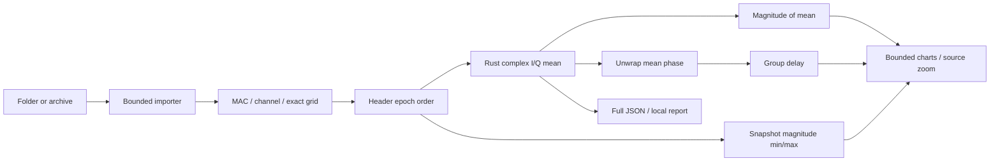

# Multi-capture channel estimation

[Developer guide](README.md) · [User walkthrough](../ui/measurements/channel-estimation/collections.md)

## Ownership and inputs

The shared bounded importer reads PNM channel-estimation captures from folders,
ZIP, TAR and TAR.GZ files (including existing nested/zstd handling). Binary
headers determine device, channel, format version, zero frequency, first active
carrier, spacing and count. Exact matches form one group; names never imply
compatibility. Source epochs are sorted ascending and byte-identical captures are
deduplicated. Input files are never changed by analysis.

`pnm::pnm::analysis::channel_estimation` owns full-resolution numerical results.
`viewer::measurements::channel_estimation::collection` owns local imports,
grouping and bounded viewports. The independent Qt collection backend owns worker
lifetimes, generation rejection and native export. QML presents shared-chart
viewports and does not average, differentiate or resample the response.

## Complex mean before group delay

For the finite, available snapshots at carrier $k$:

$$
\overline{H}_k=\frac{1}{N_k}\sum_{m\in V_k}(I_{m,k}+jQ_{m,k}),\qquad
A_k=20\log_{10}|\overline{H}_k|.
$$

The implementation uses an online mean of I and Q. It preserves per-carrier
counts $N_k$. The minimum/maximum magnitude envelope is calculated from the
individual valid snapshot magnitudes, while **Avg I/Q** is the magnitude of the
complex mean. It is not an arithmetic mean of dB values and can fall below the
minimum snapshot magnitude when phases cancel.

Group delay uses the unwrapped phase of that mean:

$$
\phi_k=\operatorname{unwrap}(\arg\overline{H}_k),\qquad
\tau_k=-\frac{1}{2\pi}\frac{d\phi_k}{df}.
$$

For a uniform grid of spacing $\Delta f$, interior derivatives use
$(\phi_{k+1}-\phi_{k-1})/(2\Delta f)$. The first/last carriers use forward/backward
first-order differences. Exported delays are seconds; the chart displays
microseconds. Negative delay is retained.

Read-only algorithm reference: PyPNM commit
`82bbf79fe04a0b5e766dc3eb4d5ca2004008bca9`,
`src/pypnm/api/routes/advance/analysis/signal_analysis/group_delay_calculator.py`,
`GroupDelayCalculator.__init__` (`np.mean` of complex snapshots) and
`compute_group_delay_full` (unwrap, centered interior, first-order edges).
This independently implemented Rust calculation matches that order and edge
policy for finite, contiguous input. No Python runtime or sidecar is added.

Excluded pairs do not contribute to the mean. Zero complex means retain zero I/Q
but have undefined magnitude and phase-derived delay. Missing/zero/nonfinite
values split phase-unwrapping runs; no slope crosses a gap. These explicit
missing-value rules extend the reference calculator rather than guessing a
coefficient. The original single-capture second-order edge policy is unchanged.
No phase registration, equalization, smoothing or frequency-grid alignment is
introduced. Phase changes over pi remain ambiguous. PLC shading is omitted
because these captures do not identify carrier types.

## UI, lifecycle and reports

The collapsed DS Channel Estimation gutter opens Multi Capture. Users choose a
folder/archive, select a MAC and compatible channel group, then switch between
magnitude (Min/Avg I/Q/Max) and mean-derived group delay. The shared chart handles
drag/wheel zoom, double-click reset and an explicit Reset zoom action. All views
reference full-resolution source indices, retain gaps and preserve metric-switch
zoom. Group replacement resets the range. Global line styles and theme colors
remain authoritative.

Imports and aggregation run off the UI thread. Cancellation invalidates queued
callbacks; failures retain the previous usable collection and show a popup.
Export is create-new only and retains full arrays/counts/source provenance.
Reports use the existing local renderer with derived classification, scalar
provenance and explicitly labeled plot-axis bounds. Decimated curves are not
recast as independent evidence; full trace arrays remain in the JSON export. Prepared
question version 1.1 distinguishes playback from complex averaging, units and gaps without
implying modem diagnosis. No new live provider route or automatic request exists.

## Validation

- Core tests: complex-before-phase order, independent expected endpoint slopes,
  phase unwrap/sign, cancellation to zero, counts, gaps, incompatible grids,
  nonfinite input and overflow.
- Viewer tests: mixed input types, binary-header grouping/chronology, dedup,
  ZIP import, cancellation/bounds, source zoom and create-new full JSON export.
- QML tests: both themes, selection/busy state, metric/trace controls and zoom reset.
- Native offline smoke: real lab collection, report, export, both metrics/themes,
  source zoom/reset and screenshots using `--channel-estimation-smoke`.
- Release demos: sanitize expanded sources before ZIP creation; exact manifest
  hashes and deterministic ZIP tests cover all native installer layouts.

Native Windows/macOS interactive behavior requires hosted validation; local
Ubuntu offscreen tests do not establish it.

## Chronological playback

The same bounded collection exposes `Collection::frame(group, frame)` in binary
header-time order (source name breaks equal-time ties). It reuses the existing
core analysis with one capture, so magnitude and first-order-edge group delay
retain the same units and gap policy without a second numerical implementation.
Each frame's export has a single source and unchanged full-resolution I/Q.
The bounded viewport adds `frame_index`, `frame_count`, `capture_time` and
`average_method: single_capture`, and omits temporal Min/Max overlays.

The Qt adapter retains the frequency range only on the same compatible grid.
Invalid frames preserve the previous result. QML reuses RxMerPlaybackControls
for 1/2/4/8 frames per second, stepping, stopping at the end and pausing when
hidden/blocked. This is capture playback, not waveform interpolation. The tree
supports direct capture selection. Local reports carry frame provenance; prompt
version 1.1 distinguishes playback from complex temporal averaging.

Validation covers sorted frame identity, invalid indexes, bounded viewports,
actual Next/Play/Pause clicks, zoom/reset, and native folder/archive smoke
checks with playback metadata, frame changes and dark/light screenshots.

### Fixed playback magnitude axis

Playback fixes its magnitude Y-axis from the full channel group's averaged
analysis, including the temporal Min/Max envelope and the existing plot padding.
It is calculated once per selected group and retained across captures, frequency
zoom/reset and switching back from group delay. This keeps vertical movement
visible without rescaling each frame. Changing the source group builds a new
reference range. Group delay retains its own scale. Raw coefficients and exports
are unchanged; this is a display bound, not magnitude normalization.
