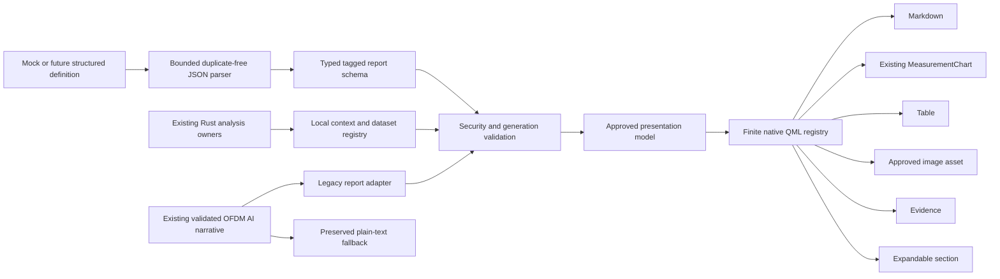

# Native dynamic engineering reports

[Documentation index](../README.md) · [User guide](../ui/engineering-reports.md)

RAVEN renders ordered native report blocks from a closed Rust-validated definition.
The implementation is independent of providers, credentials and network access.
Rust retains measurement, DSP/FEC, generation and evidence ownership. QML controls
presentation and local expansion/zoom state; it never runs model-authored code.

## Architecture and reuse

The audit confirmed reusable `Capture::chart_range`, `MeasurementChart.qml`,
existing strict AI evidence/report validation, Theme/ThemePalette controls, native
Save dialogs, QML resource registration and package/plugin deployment. No parser,
DSP, graph engine, provider SDK or browser engine was duplicated. The one new Rust
dependency, pinned `pulldown-cmark` 0.13.6, parses Markdown security-sensitive syntax;
its MIT license is retained under `LICENSES/pulldown-cmark` and generated notices.

## Schema 1.0

Examples live under `resources/reports/*.json`. The definition contains:

- `schema_version`: exactly `"1.0"`.
- `report_id`, `title`: bounded local report metadata.
- `source`: `context_id` and numeric `generation` of a trusted local owner.
- `blocks`: ordered tagged enum variants below. IDs are unique across nested sections.

| Block | Definition fields beyond `id`/`type` | Resolution |
| --- | --- | --- |
| `markdown` | `content` | Parse Markdown; reject HTML/images and nonlocal links. |
| `chart` | `chart_type: rxmer_frequency`, `dataset_id`, `title` | Existing bounded Rust viewport, dB/MHz axes, normal drag/double-click zoom. |
| `table` | `dataset_id`, `title` | Trusted typed table, original numeric strings/units, null unavailable cells. |
| `static_table` | `title`, `columns`, `rows` of strings | Small explanatory table, always labeled as not measurement. |
| `image` | `asset_id`, `caption` | Finite application asset registry; URLs never appear in definitions. |
| `evidence` | `evidence_ids`, `label`, optional `action` | Exact current registry entries with source classification, scope, unit and availability. |
| `expandable` | `title`, nested `blocks` | Same validation recursively; expansion remains local UI state. |

Unknown fields/variants and duplicate JSON keys are rejected. Schema 1.0 is separate
from the existing AI narrative/evidence schema v1; the provider API is unchanged.
A future direct structured response must use `reports::parse` with the active owner
context, never directly bind provider JSON to QML. Unsupported structured reports
must retain their validation error, not fall through to executable/rendered content.

## Budgets and trust boundaries

Definitions are at most **128 KiB**. The existing JSON owner limits nesting to 20;
report sections to four levels, total blocks to 48, Markdown text to 16 KiB/block,
Markdown syntax nesting to 16, and final presentation to 512 KiB. Titles are 200
bytes, IDs 96 safe ASCII characters, captions 512 bytes. Tables allow 12 columns,
64 rows and 256 bytes/cell; evidence blocks allow 16 unique current references.
Charts retain at most 1,024 source display points from the existing decimator.
Total rendering cost is capped at 2,048 table cells and 4,096 plotted display points
across all sections, so repeating small blocks cannot bypass GUI work limits.
These are application budgets, not DOCSIS or provider protocol limits.

A `Context` is constructed by trusted Rust code, never from model JSON. It owns
registered charts/tables/evidence for one capture/run. Source classification is
locally attached: measured PNM, simulation, derived findings, demonstration and AI
interpretation remain distinct. Values are copied, including exact large integer
strings and nulls. No AI-authored chart arrays or calculations are accepted.
Snapshots deliberately summarize at most 64 scalar fields, explicitly disclosed;
existing full-resolution JSON exports remain the complete measurement export.

Missing/stale chart or table data creates an explicit unavailable block with no old
values. Wrong report source/generation, unknown or stale evidence, unknown image
assets and invalid navigation targets fail closed. Charts zoom the already bounded
local viewport; deeply zoomed ranges may have no registered display samples and
never fabricate/interpolate extra data. Use the source workspace for full-resolution
analysis. Normal measurement behavior and export contracts are unchanged.

Markdown uses Qt's native selectable Markdown text, with Rust syntax validation
before rendering. Raw `<` markup, HTML events and image events are rejected. Code
blocks are literal display, never executed. Only links to existing report block IDs
are permitted; QML handles those internally and never calls an OS URL opener. Model
JSON cannot choose Loader paths: the renderer maps a finite block-type switch to
application-owned components. Image URLs are resolved by Rust and independently
allowlisted in QML. Supported assets include PNG/JPEG and WebP where Qt's installed
image plugin supports it; unsupported decoders show an explicit unavailable state.

The sole initial navigation action is `open_rxmer` with a current registered target.
It is **disabled with a reason**: a safe route into every existing workspace is not
yet connected. No shell execution, file access, network calls, credential changes,
simulation configuration edits or capture mutations are report actions.

## Analysis coverage and lifecycles

A common **Reports** toolbar action applies to every existing PNM measurement and
left-gutter analysis. Each backend builds the snapshot in Rust, using its own result
and generation. Opening a playback report pauses playback. Reports close and clear
when their owner data or workspace changes; a new/rejected fixture replaces and
disposes the old controls, including expanded-section state.

| Analysis | Current local report owner |
| --- | --- |
| All nine single capture types (RxMER, spectrum, channel estimate, constellation, histogram, FEC, modulation, both pre-EQ types) | `ViewerBackend::engineering_report("single")`; capture metadata/table/evidence, plus real RxMER plot. |
| DS Channel Estimation Multi Capture / Playback | Complex-average or individual-capture snapshot with provenance, mode and counts; prepared question 1.1. |
| RxMER Min-Avg-Max and Playback | Existing RxMER collection view snapshot; current derived values. |
| Spectrum Min-Avg-Max and Playback | `SpectrumCollectionBackend::engineering_report`; current derived view snapshot. |
| US Pre-EQ Compare | Existing Rust comparison snapshot; no repeated correction arithmetic. |
| OFDM Profile Performance | `ProfilePerformanceBackend::engineering_report`; existing MERLIN result/chart snapshots. |
| Accepted OFDM AI commentary | `reports::adapter::from_ai_result` repeats current strict validation, escapes narrative Markdown, resolves original evidence and attaches interpretation provenance. |

Every new analysis/test must apply `skills/pnm-analysis-assistance/SKILL.md`, add a
prepared-question/evidence requirement and extend this matrix. Other PNM analyses
have local reports and prepared question text; **live AI remains the existing
explicit OFDM-only route**. The framework does not enable additional uploads.

## Modules and extension points

- `apps/viewer/src/reports/schema.rs`: closed input types.
- `context.rs`: trusted chart/table/evidence registry and classifications.
- `validation.rs`, `markdown.rs`: security, budgets and reference resolution.
- `adapter.rs`: local analysis owners and accepted AI narrative adaptation.
- `fixtures.rs`, `resources/reports/`: four offline examples and sanitized resources.
- `apps/qt/src/reports.rs`: independent gallery lifecycle and explicit new-file export.
- `apps/qt/qml/ai/report/`: native finite renderer and components.

To add a block, first define its versioning/budget/trust contract, extend the Rust
enum and resolver, register exactly one application-owned renderer and QML resource,
and add malicious-input, theme, replacement and native tests. To add a dataset,
register the existing Rust owner's bounded results/generation; do not recalculate
numbers or expose arbitrary JSON/file resource access. Image additions need an
approved asset ID, finite resource mapping, notices/provenance and decoder tests.

## Validation mapping

| Requirement | Evidence |
| --- | --- |
| Schema/version/type/ID/field/duplicate-key rejection | `closed_schema_rejects_versions_duplicates_unknown_blocks_and_actions` |
| Depth, blocks, bytes, text/table bounds | `complexity_and_table_shape_are_bounded` |
| Total GUI work across nested sections | `total_widget_and_plot_cost_is_bounded_across_sections` |
| Exact large counters, Markdown depth, sanitized fixture identity | `numeric_formatting_retains_large_integer_strings_and_markdown_depth_is_bounded` |
| Missing/stale data and wrong owners | `missing_and_stale_datasets_never_leak_old_values` |
| Evidence/assets/actions/paths | `references_assets_and_privileged_paths_fail_closed` |
| HTML/images/URLs/script links and literal code | `markdown_html_remote_images_urls_and_javascript_links_are_rejected` |
| Exact chart values, ordering, nulls, disabled actions | `offline_fixtures_preserve_block_order_and_measured_values` |
| All capture types and collection/test snapshots | `all_single_measurements_and_collection_snapshots_share_the_renderer_contract` |
| Legacy AI contract and HTML escaping | `accepted_narrative_adapts_to_rich_blocks_without_weakening_reference_checks` |
| Markdown selection, System/dark/light, wide scrolling, registry, disposal, images/chart | `tst_engineering_reports.qml` |
| Scrollbar geometry, scroll position and thumb dragging | `test_vertical_scrollbar_geometry_and_long_document` |
| Installed Qt resources, all blocks and invalid/replacement lifecycle | `--report-smoke OUTPUT_PREFIX` native offline smoke |

Native Windows/macOS runtime behavior and package bytes require their respective
native release validation. No workflows, signing, installation or publication are
changed by this implementation. The installer gate remains active; see [packaging](../release/packaging.md)
for the current budget.

Dependency review pins the patched Markdown parser; wikilink extensions remain
disabled. See [RUSTSEC-2026-0433](https://rustsec.org/advisories/RUSTSEC-2026-0433.html).
Report headings, tables, captions and shared button labels explicitly render plain
text; only the validated Markdown component enables Markdown formatting.

Approved internal Markdown links are displayed as themed native navigation buttons
with their text retained in the document. This avoids Qt's fixed dark-mode link
blue without enabling HTML/CSS. Rust validates link destinations and preserves
original Markdown in the approved model alongside its presentation text.

Custom report scrollbars declare their viewport geometry and synchronize the
vertical thumb with the scroll content. The QML regression test checks long-document
overflow, actual bar dimensions, scroll position and mouse dragging; content-height
checks alone did not catch a misplaced native indicator.

## Verified development result — 2026-11-19

Ubuntu 22.04 development validation passes 238 all-feature workspace Rust tests,
189 QML tests, six Qt adapter tests, Rust/Qt formatting and Clippy with warnings
denied. The existing package-contract suite passes ten tests and the SW-QA hygiene
gate passes, including nine helper tests. Both skill discovery paths validate for
the new-analysis skill and the updated AI integration skill.

The rebuilt native offline gallery reports `REPORTS_OK`; the existing native OFDM
AI demo reports `AI_DEMO_OK`, including the accepted-report adapter assertion.
Dark/light screenshots were visually reviewed and linked in the user guide.
PNG and JPEG decode; this Qt SDK lacks a WebP decoder, and the image block displays
its unavailable state. This is local/offscreen validation, not a live provider call
or Windows/macOS runtime validation. Credentials, installation and releases were
not changed.

The local Ubuntu package build and artifact verifier pass. The desktop DEB is
**34,227,488 bytes**, below the unchanged 50,000,000-byte gate; matching CLI
artifacts and SHA-256 checksums verify. The existing locally extracted `patchelf`
was used; no host package was installed. Generated packages remain ignored under
`local/engineering-reports-packages-scroll-20261119/` and were not published.
