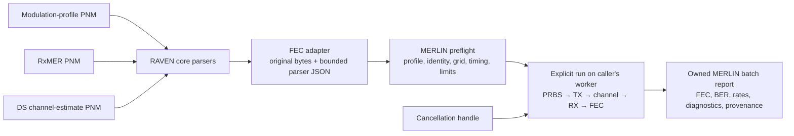

# MERLIN FEC adapter

RAVEN's optional Rust adapter calls MERLIN's public simulation API directly.
It is implemented under `apps/viewer/src/simulation/fec/`. This is a backend
interface; there is no FEC screen or Qt binding yet. No Java/JNI, Python, CLI
subprocess or second implementation of the scientific calculations is involved.

## Ownership and flow



The modulation profile selects actual captured carrier assignments. RxMER feeds
MERLIN's residual-noise model; the complex channel estimate feeds its channel
response. MERLIN also owns receiver correction, soft decisions, BCH/LDPC,
iteration diagnostics and source-bit comparison. RAVEN does not calculate FEC
from MER thresholds or duplicate those algorithms. Results are simulation
outcomes, not a prediction of one particular physical modem.

The adapter accepts exactly one capture of each kind and one selected profile.
`from_json` also accepts MERLIN `NamedCapture` objects containing existing decoded
JSON, preserving that actual source format rather than inventing binary originals.
`FecExperiment::profile_ids` discovers the captured IDs rather than guessing.
`FecExperiment::new` imports and preflights without starting work. `run` executes
synchronously on the caller's worker and takes MERLIN's cloneable `RunControl`.
Cancellation retains MERLIN's partial/not-started results. Do not call `run` on
the Qt event thread. No separate worker, progress event protocol or GUI session
manager is added by this adapter.

## Dependency and decoder boundary

Enable Cargo feature `viewer/merlin-fec`. The initial integration pins v0.4.0 revision
`096d5a476194d4f2e016863d723b225257bb6037` in `apps/viewer/Cargo.toml` and
`Cargo.lock`. Only the Apache-2.0 engine and its licensed codec dependencies are
consumed; MERLIN's Qt application and Python bindings are not imported or copied.
The GPL-3.0-only RAVEN adapter remains in the desktop service crate.

The dependency is optional and disabled in ordinary desktop builds. Local and
hosted validation explicitly enable it, while existing packages remain unchanged.
Building with the feature needs the pinned Git source/crates available in Cargo's
cache; running the resulting simulation does not access the network.

RAVEN parses the existing captures with its own `pnm` core, then passes bounded
core-parser JSON and the original binary bytes to MERLIN's `from_decoded` APIs.
It does not use MERLIN's `pnm-input` crate, which currently depends on the old
viewer repository. This avoids a second decoder, dependency cycle and old-repo
fetch. It deliberately excludes UI-derived chart/analysis JSON.

MERLIN's explicit producer allowlist currently names `pnm-decode` 0.3.6 only.
The adapter does **not** claim that RAVEN is that producer or bypass that allowlist:
it uses the documented optional-contract structural import with `None`, and
verifies current RAVEN parser outputs with integration tests. This is tested
compatibility, not a frozen cross-version JSON guarantee. Dependency/parser
updates must rerun these tests and review the contract. Original hashes, epochs,
bytes and decoded provenance remain separate in MERLIN's owned input models.

## Settings and results

`FecSettings` contains a captured `profile_id`, explicit DOCSIS protocol,
`OcdOverrides` and MERLIN `EvaluationOptions`. The adapter sets the two source
selection fields to the supplied RxMER and channel estimate; other options,
including receiver mode, observation duration, runtime, LDPC iteration/detail
limits, PRBS/noise seeds and profile-time tolerance, remain caller-controlled.

Defaults belong to MERLIN, including CP/roll-off/interleaver assumptions and
100 ms observation with a separate 30-second host-runtime budget. A runtime limit
can produce partial results; it is not the requested RF observation duration.
Missing/ambiguous geometry requires an explicit validated override. Capture
identity and frequency-grid mismatches are rejected without interpolation or
rewriting timestamps. Profile-time tolerance defaults to zero; the test fixtures
need an explicit 90,000-second tolerance because their epochs differ.

`configuration()` exposes MERLIN's resolved values and their origins. `run()`
returns its unmodified `BatchReport`, including schema version, lifecycle status,
FEC counters, post-FEC BER, compared bits, payload rate, receiver diagnostics and
source provenance. Iteration detail remains in MERLIN's diagnostics; no UI-side
summary is calculated here. Missing metrics remain absent. A completed run can
still contain uncorrectable codewords. Errors retain either RAVEN's original
parser diagnostic or MERLIN's structured `ApiError` category.

## Verification

Run the adapter's fixture-backed contracts from the RAVEN root:

```bash
scripts/cargo-local.sh test -p viewer --features merlin-fec \
  --test fec_simulation --locked -- --nocapture
```

The tests use existing sanitized `pnm-fixtures` captures. They cover profile
catalog discovery, three-capture preparation, immutable exports, original hash
provenance, wrong file roles/types, absent profiles, strict epoch/channel
rejection, pre-cancellation and a real bounded PRBS/FEC run. The run selects
profile 0, requests 1 ms observation and permits at most 300 seconds host runtime for slower native CI runners.
A passing fixture does not establish every possible profile, receiver mode,
impairment or platform. Native CI retains the existing platform matrix.

The first Qt integration should add capture selection, settings, a cancellable
worker and bounded result presentation on top of this adapter. Those controls
are planned and are not part of this implementation.

## 192 MHz / 8 MHz notch demonstration

The subset copied from MERLIN's `examples/workbench/cl-192mhz-8mhz-notch`
lives under `tests/fixtures/merlin/cl-192mhz-8mhz-notch/`. It includes the synthetic
4096-QAM Profile 3, flat 42 dB RxMER, 8 MHz/10 dB notch RxMER and adapted channel
estimate, plus original licenses/notices/provenance and a SHA256 copy manifest.
The channel shape is adapted to a synthetic frequency grid, not a measurement
at those frequencies. These remain JSON; no quantized binary files are invented.

Run the fixture-backed native Rust example (no Qt or Python):

```bash
scripts/cargo-local.sh run --release -p viewer --features merlin-fec \
  --example fec_notch --locked -- --notch
```

Use `--flat` for the same supplied channel with background-only RxMER. It prints
MERLIN's owned batch JSON. Parameters match the upstream CMCE case: 192 MHz,
25 kHz, CP 512, roll-off 128, interleaver 16, supplied-channel correction, 10 ms
observation, 50 iterations, 300-second host limit, PRBS seed 32767/noise seed 41.
The notch is 371 MHz inclusive to 379 MHz exclusive (320 grid positions), away
from PLC. Release optimization is recommended for the actual decoder workload.
Input timestamps already agree, so this case needs no association-time relaxation.

### Observed notch result

The local 10 ms CMCE-notch run completed with 1,273 observation-window codewords,
all corrected and none uncorrectable. It compared 18,117,336 payload bits with
zero post-FEC bit errors. These counts come directly from the MERLIN batch report,
not a threshold calculation. This single fixed-seed outcome does not establish
a general notch limit. Whole-run decoder diagnostics include completion/drain
and retain their separately labeled scope.

Both optimized runs completed locally with the same supplied channel estimate:

| RxMER case | Window codewords | Clean | Corrected | Uncorrectable | Post-FEC bit errors |
| --- | ---: | ---: | ---: | ---: | ---: |
| Flat 42 dB | 1,273 | 216 | 1,057 | 0 | 0 |
| 8 MHz notch at 10 dB | 1,273 | 0 | 1,273 | 0 | 0 |

The separately scoped all-completed payload LDPC mean was 0.829804 iterations
for flat and 2.023529 for notch. Zero-iteration early syndrome acceptance is
included in MERLIN's mean; these are decoder diagnostics, not FEC counter
estimates. The debug and optimized notch runs agreed on window FEC/bit results.

Local validation: six adapter contracts, the workspace feature-enabled suite,
70 existing feature-disabled viewer tests, Clippy with warnings denied,
153 QML tests and four Qt adapter tests passed. Workflow/shell lint, version
consistency, fixture hygiene and copied-file hashes passed. Windows/macOS
execution of the new optional adapter remains for native CI; this work has not
been published or added to the installed GUI.

Development setup calls the separate
`scripts/fetch-development-dependencies.sh` helper after Rust preparation.
It fetches the pinned engine and both locked dependency sets without building.
It can also run independently; see [development setup](../install/development.md#locked-rust-dependency-sources).
Installer tests cover repeated locked fetches and propagation of fetch failures;
no system package installation is required for those tests.

## Update the MERLIN dependency

From the RAVEN checkout, select the highest stable semantic release tag or an
explicit tag:

```bash
python3 tools/development/update-merlin.py --dry-run
python3 tools/development/update-merlin.py
python3 tools/development/update-merlin.py v0.4.0
scripts/cargo-local.sh test -p viewer --features merlin-fec --locked
scripts/cargo-local.sh clippy -p viewer --all-targets --features merlin-fec --locked -- -D warnings
```

The helper resolves public Git tags; latest means the highest stable
`vMAJOR.MINOR.PATCH`, excluding prereleases. It writes the resolved exact commit
to the existing MERLIN dependency in `apps/viewer/Cargo.toml`, updates the adapter's
revision constant, and runs a targeted Cargo update for `Cargo.lock`. Unrelated
TOML settings remain intact. Compatible transitive lockfile changes may result;
review the complete diff. This prepares sources without enabling FEC in Qt.

It also refreshes upstream license/NOTICE files under `LICENSES/merlin/`, including
the AFF3CT MIT notice and QAM resource attribution. `SOURCE.txt` records the tag
and commit. The existing release packager includes this directory with RAVEN's
licenses. Existing PyPNM fixture notices remain in place. Cargo dependency
license collection remains responsible for other resolved third-party crates.

Missing tags, unavailable legal files or remote failures stop the update.
If Cargo resolution fails, the manifest, lockfile, runtime revision and legal
files are restored. Cargo's downloaded cache remains. Do not run concurrently
with other dependency edits. The helper does not commit, push, build or execute
tests; a new MERLIN release still needs adapter compatibility testing.
