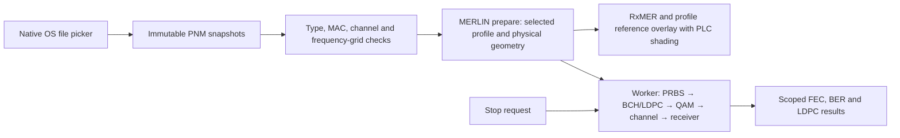

# OFDM Profile Performance

[Developer index](README.md) · [User guide](../ui/measurements/ofdm-profile-performance/README.md)

## Ownership and flow

This native Qt workspace uses RAVEN's capture parser and MERLIN's pinned public
Rust API. Scientific calculations, preflight, PRBS generation, channel processing,
equalization, and BCH/LDPC execution remain in Rust. Qt presents bounded DTOs.



The left gutter owns this multi-file workflow. Single Capture remains independent.
`apps/viewer/src/simulation/fec/workspace.rs` owns snapshots, role validation,
settings, preflight, chart composition, and compact results. `fec/batch.rs` owns validated checkbox subsets and independent sequential cases.
`fec/mod.rs` supplies
the optional-channel API shared with other callers. The existing required-channel
constructor remains compatible.

`apps/qt/src/profile_performance.rs` contains only native bindings and worker
lifecycle. CXX-Qt 0.7.3 requires registered `rust_files` in the same directory;
placing this bridge beside the existing registered bridges is necessary. Numerical
and preparation implementation stays in the viewer feature folder.

## Input and receiver contracts

The input popup requires binary PNM modulation-profile and RxMER captures. Channel
estimation is optional. Each role is checked before replacing its previous
snapshot; choosing the wrong type or a malformed file produces the existing error
popup. No input bytes, epochs or filenames are rewritten. Profile choices come
from captured IDs rather than assuming their order or count.

Continue preflights every checked profile before replacing the session. It
rejects empty, duplicate or over-budget selections (maximum 16 cases). A failure
in any selected profile leaves the previous chart intact. Each case calls MERLIN preflight. Required identity and grid checks include CM MAC,
channel ID, subcarrier-zero frequency, first carrier, spacing and selected-profile
extent. Inputs are not resampled or aligned by index to conceal a mismatch.
Missing sources or an unsupported profile/geometry keep the popup open.

The visible capture-time tolerance defaults to 86,400 seconds and is passed
explicitly to MERLIN's profile association policy. Set it to zero for matching
profile/RxMER epochs. This does not rewrite timestamps or assert simultaneous
acquisition. Channel-source selection is explicit and its identity/grid is checked;
this UI does not infer a nearest-time channel estimate.

With no CH-EST, the channel is explicitly unity; measured RxMER supplies noise.
With CH-EST and MCE off, MERLIN uses the supplied channel response and supplied-H
receiver correction. With MCE on, the same response impairs transmission but
receiver correction is estimated from received pilots and reliability. MCE is
available only with an attached CH-EST capture; the Rust boundary also enforces
this requirement. Removing CH-EST disables MCE. No receiver implementation is
copied into Qt or the adapter.

The first screen uses DOCSIS 3.1 interpretation and MERLIN's resolved physical
defaults: geometry comes from profile admission with explicit/defaulted origins
in the engine. Fine-grained OCD and MCE tuning controls are future work. The
observation is explicitly 10 ms, the host budget is 300 seconds, and the engine's
50-iteration limit and deterministic seeds remain in effect. Host runtime includes
acquisition/drain and is not the observation duration.

## Overlay and counters

RxMER is plotted in dB against the selected profile's existing Rust-computed
Shannon reference, also in dB. The latter is a theoretical reference rather than
an empirical decoding threshold:

\[
\mathrm{MER}_{\mathrm{Shannon},b}=10\log_{10}(2^b-1).
\]

The modulation trace uses steps; non-data assignments remain gaps. The protected 6 MHz PLC neighborhood comes from MERLIN's validated physical
layout and is shaded behind both traces; its geometry is not recalculated in Qt.
The plot supports the shared drag-to-zoom/double-click reset. A viewport bounds the RxMER trace to 1,024 points; all selected profile traces
share one additional 1,024-point budget through the existing core decimator. Simulation always uses
original full-resolution inputs, independent of zoom. Chart line width/colors use
the shared theme settings. Profile references have a distinct theme-aware color.

FEC Performance explicitly starts simulation on a Rust worker. The results popup
shows actual MERLIN FEC observation-window counts (total, clean, corrected,
uncorrectable, undetected), compared payload bits, bit errors and BER. LDPC sums,
mean, failures, NCP/PLC iterations and BCH failures are labeled **all completed**,
which includes completion/drain and may differ from the observation window.
Missing results display a dash, never an invented zero. Partial/cancelled/failed
statuses remain visible; an empty result is not declared successful.

Checkboxes in the input dialog choose prepared IDs; workspace checkboxes select
any subset of those IDs. Inputs are immutable and shared through Arc; each engine
case retains independent PRBS/channel/FEC state. The batch runs profiles in
ascending ID order, using the same explicit receiver/options/seeds. Its results
DTO contains independent entries with original profile IDs, never aggregate BER
or codeword counts. A shared stop handle cancels the active case and subsequent
cases remain NotStarted. Any failed case retains its error and does not erase
other cases. Runtime is bounded per case, so total elapsed time scales with the
number selected. An empty subset retains the RxMER plot but disables execution.

Input replacement removes the old prepared session and disables its checkboxes;
selecting an old checkbox cannot re-enable a session for stale capture bytes.
Changing a valid subset invalidates old results and resets the chart range.
One active worker owns the session while running. Selection and preparation are
disabled until it finishes; Stop signals cooperative cancellation and does not
claim completion before the worker responds. Closing the results popup leaves the
run active. Destroying the backend requests cancellation. Generation guards drop
stale callbacks. Failed input/preflight does not overwrite the previous chart,
but changed inputs invalidate FEC readiness until Continue succeeds again.

## Validation

Rust workspace tests cover optional H, MCE admission, missing sources, wrong file
roles, profile discovery, channel/MAC/frequency mismatch, time tolerance, bounded
zoomed overlays and cancellation without fabricated counters. QML tests cover
required inputs, MCE availability, waiting for successful preflight, profile ID
selection, overlay binding and FEC gating. Existing chart/theme suites remain in
the complete Qt gate. Native smoke uses the actual registered Rust backend,
binary fixtures, rendering and real decoder execution, rather than mocked DSP.

An explicit developer smoke command accepts local fixture URLs and an existing
writable output directory prefix:

```bash
QT_QPA_PLATFORM=offscreen QT_QUICK_BACKEND=software \
LD_LIBRARY_PATH="$PWD/local/qt/6.8.3/gcc_64/lib" \
apps/qt/target/debug/raven --ofdm-smoke \
  "file://$PWD/tests/fixtures/pypnm/tests/files/modulation_profile.bin" \
  "file://$PWD/tests/fixtures/pypnm/tests/files/rxmer.bin" \
  "file://$PWD/tests/fixtures/pypnm/tests/files/channel_estimation.bin" \
  "$PWD/local/ofdm-profile" --mce --ofdm-profiles=0,1,2,3
```

Replace the channel URL with `none` and omit `--mce` to exercise unity. This mode
suppresses update checks, saves real dark/light workspace and results frames, and
fails on preparation, rendering or incomplete FEC execution. The smoke imports captures through the same multi-file Rust worker as the input
popup. Add `--ofdm-input-only` to capture the actual input controls in both themes
without running FEC. The optional
`--ofdm-profiles` list selects captured IDs; its default remains Profile 0. No network retrieval,
system installation or publication occurs. Linux smoke evidence does not establish
Windows/macOS runtime or native file-picker behavior there. Hosted packaging must
still verify the 50,000,000-byte per-installer limit with the newly linked engine.

Local native smoke results on the bundled Profile 0 captures, 10 ms observation:

| Channel / receiver | Window codewords | Clean | Corrected | Uncorrectable | Compared bits | Bit errors |
| --- | ---: | ---: | ---: | ---: | ---: | ---: |
| Unity | 840 | 840 | 0 | 0 | 11,954,880 | 0 |
| Supplied CH-EST / MCE | 840 | 838 | 2 | 0 | 11,954,880 | 0 |

The MCE run's all-completed histogram contains 844 words (842 accepted at zero
iterations and two at one iteration), iteration sum 2 and mean 0.002369668. NCP
iterations total 1,087 and PLC iterations total 40. Neither payload LDPC nor BCH
failures were reported. These results use fixed engine seeds and these fixtures;
they do not establish a general channel threshold. Native dark/light frames are
linked in the user guide.

About's final Uninstall action preserves Windows Installed apps navigation.
Ubuntu/macOS open their removal instructions; no unattended self-removal is added.
It is disabled during active work or installation. QML coverage checks its end
position, both themes and platform-specific routing.

Checkbox validation covers arbitrary valid subsets, empty selection and re-selection,
duplicate/unknown IDs, shared overlay point limits, preserved per-profile
NotStarted rows after cancellation, input-dialog checkboxes and independent FEC
rows with unavailable counters shown as dashes.

The Qt development profile optimizes only docsis-ofdm-fec, fec-codec and
ldpc-toolbox to avoid impractically slow unoptimized simulation loops in the VM.
RAVEN's UI and adapter retain normal debug builds. Release optimization remains
unchanged. Native batch smoke allows the existing per-case timeout for each
requested profile, rather than treating several sequential runs as one case.
`--ofdm-view-only` captures the native prepared overlay without running decoders;
it never fabricates a FEC results screenshot or claims simulation success.

Four-profile MCE native validation completed in 47.66 seconds on the local VM
using the optimized engine dependencies in the Qt development build:

| Profile | Window words | Corrected | Uncorrectable | Compared bits | Bit errors | All-completed mean LDPC iterations |
| --- | ---: | ---: | ---: | ---: | ---: | ---: |
| 0 | 840 | 2 | 0 | 11,954,880 | 0 | 0.002370 |
| 1 | 1,047 | 131 | 0 | 14,900,904 | 0 | 0.124762 |
| 2 | 1,149 | 1,060 | 0 | 16,352,568 | 0 | 0.925412 |
| 3 | 1,252 | 1,252 | 0 | 17,818,464 | 0 | 1.127490 |

An earlier fully unoptimized four-case smoke reached the old single-case harness
timeout. The harness now composes the per-case time allowance, and the engine
dependencies are optimized for development. The 10 ms observation, 300-second
per-case host limit, receiver policy, seeds and decoder settings are unchanged.
All 194 Rust workspace tests, 159 QML tests, four native Qt adapter tests, Clippy
and the native build passed. Hosted platform validation remains separate.

## Multi-file input selection

The native input popup offers one OpenFiles picker for two or three binary PNM
captures. Rust detects roles from decoded contents, rejects duplicate/unsupported
types, and preflights MAC/channel/frequency-grid/time compatibility using the
existing MERLIN preparation path before atomically replacing the selection.
A required-only pair clears stale optional channel estimation. Failed reads and
preflight leave prior inputs and the prepared chart intact. No simulation runs
during import. Individual role pickers remain available. URL messages and file
counts are bounded, file reads use existing capture limits, and preparation stays
on the owned worker with existing generation guards. Continue revalidates the
chosen profiles, receiver mode and current time tolerance.

The Ignore channel estimation checkbox bypasses H only in the cloned evaluation
inputs. The selected immutable channel remains attached and displayed, so turning
Ignore off restores it without file I/O. MCE is disabled while Ignore is checked.
Compatibility checks still apply to every attached capture at multi-file import.

For native bypass validation, append `--ignore-channel --ofdm-view-only` to the
three-capture smoke command and omit `--mce`. The smoke checks unity is used while
the channel remains attached. Normal smoke preparation uses the same selection
operation as the input dialog.
