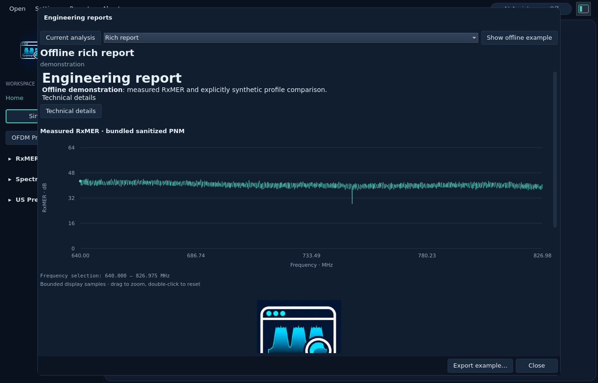

# Engineering reports

[User guide](README.md) · [Report design](../development/engineering-reports.md)

Select **Reports** on the top toolbar from any single PNM capture or left-gutter
analysis. The report uses the currently loaded Rust-owned results. Playback is
paused while reviewing its frame. If no capture is open, Reports opens the offline
example gallery. **Current analysis** returns to the selected measurement/test.

Reports can contain selectable Markdown explanations, RxMER charts, tables,
approved illustrations, source evidence and expandable technical details. Scroll
vertically through the document, and horizontally inside wide tables. Drag across
an RxMER plot to zoom its bounded display data; double-click resets it. Use the
original measurement workspace for finer source-resolution analysis.

Measured, simulated, derived and explanatory values are labeled. Missing values
stay unavailable. A report does not rerun measurements or simulations. Source
navigation buttons are currently disabled with a reason. Changing the capture,
result, group, frame or workspace clears its old report.

## Offline examples

Choose **Markdown basics**, **Engineering report** or **Rich report** from the
selector, then **Show offline example**. The rich example combines a real sanitized
RxMER fixture, a **synthetic** profile table, local PNG/JPEG/WebP illustrations,
evidence and expandable details. WebP requires the deployed Qt decoder plugin.
**Rejected report example** demonstrates a validation error; the old report is
cleared. No API key, AI subscription or network connection is needed.

Launch directly from a development checkout:

```bash
cd /home/dev01/Projects/raven &&
./scripts/qt-desktop.sh --reports-demo
```

After building once, add `--skip-build` before `--reports-demo` to reuse the binary.
The demo flag also disables the normal startup update check. **Export example…**
saves the approved presentation to a new JSON file using the OS Save dialog;
existing files are not overwritten. It exports display data, not a full capture.
Use the existing measurement export for full source JSON.

## AI Assistance

Accepted OFDM AI reports use the same native renderer with their original evidence
and scientific provenance. A validated plain-text fallback remains available if
rich conversion fails. No provider endpoint, credential behavior or approval step
changes. Other PNM views have local reports and prepared-question requirements;
live AI analysis remains the current explicit OFDM feature.

## Screenshots

Native offline examples, captured in the Ubuntu development build:



[Light report](images/reports/report-light.png) ·
[Dark table and evidence](images/reports/report-details-dark.png) ·
[Light table and evidence](images/reports/report-details-light.png)
