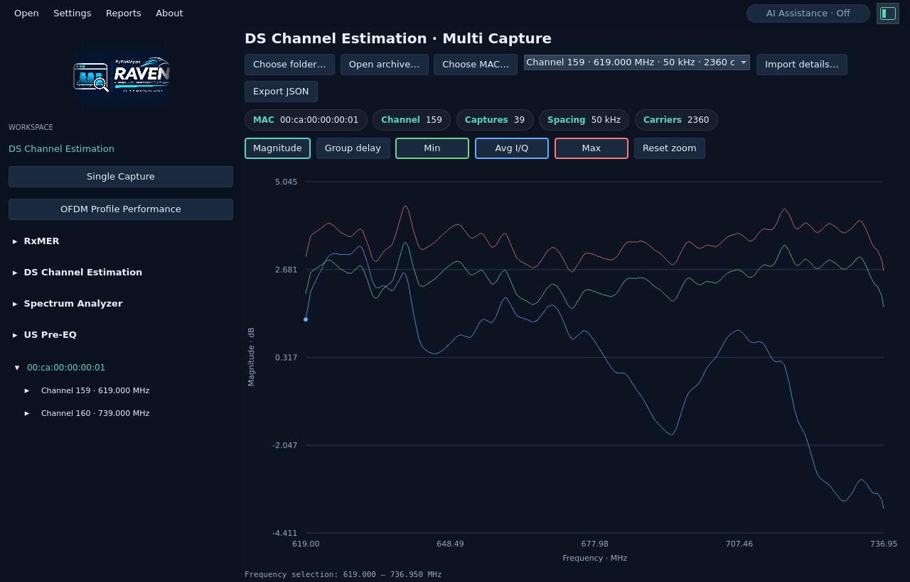
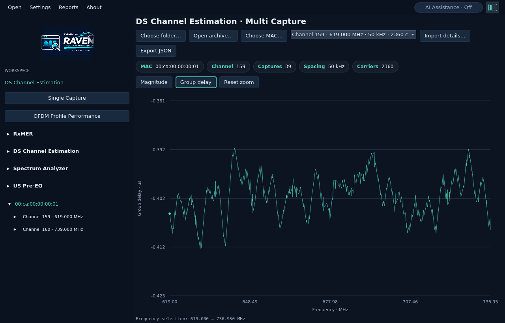
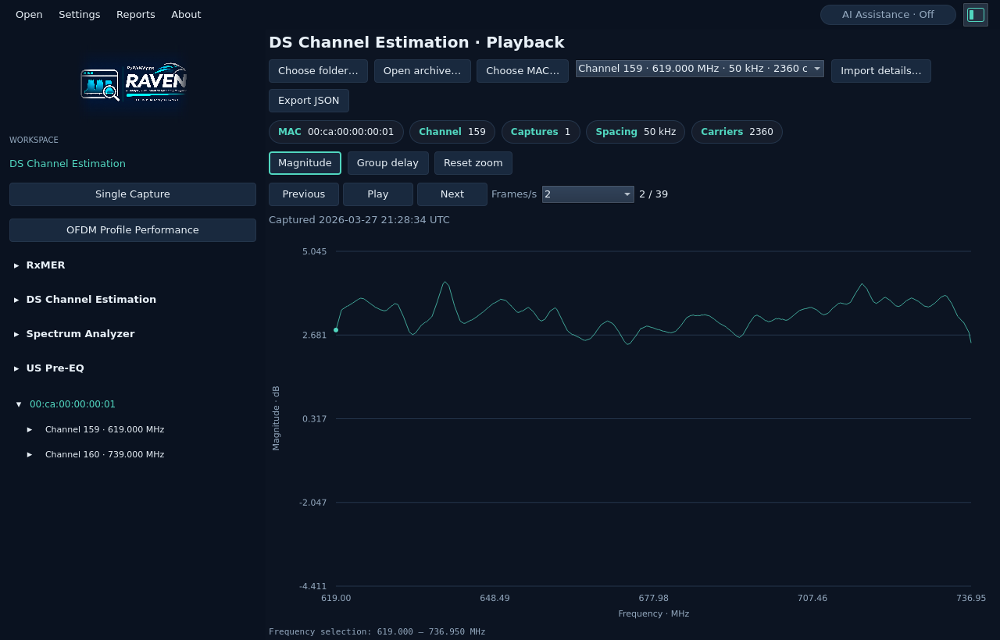
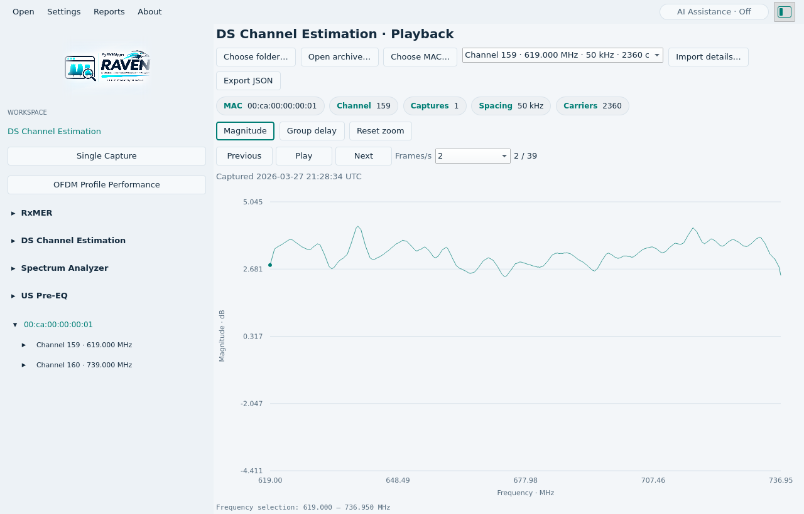

# Channel estimation — Multi Capture

[Single capture](README.md) · [Demo files](../../examples.md) · [Project README](../../../../README.md)

Use **DS Channel Estimation → Multi Capture** in the left gutter to compare
captures over time. Choose a folder or open a ZIP, TAR or TAR.GZ archive, select
the MAC address, then select a channel in the tree or channel list. RAVEN reads
the files to group compatible captures and order capture times; filenames do
not need to follow a naming convention. Import errors appear in a popup; skipped
files and duplicates are listed under **Import details**.

## Try the examples

Installed demos include `files/demo/channel-estimation/multiple-captures.zip`.
It contains **75 real lab captures across two channels** of the sanitized modem
`00:ca:00:00:00:01`. On Ubuntu the full path is
`/opt/raven/files/demo/channel-estimation/multiple-captures.zip`; on Windows it is
under `C:\Program Files\RAVEN\files\demo\channel-estimation`. On macOS it is under
`RAVEN.app/Contents/Resources/files/demo/channel-estimation`.

In a source checkout, choose
`tests/fixtures/demos/channel-estimation-multi-capture/` as the folder. The local
VM demo is also copied to `~/Downloads/demo-channel-estimation-multi-capture/`.
Only MAC fields changed; coefficients and original capture times are retained.

## Magnitude and group delay

**Magnitude** shows three curves. **Min** and **Max** show the smallest/largest
snapshot magnitude at each carrier. **Avg I/Q** averages the complex coefficients
first and shows the magnitude of that averaged response. Different phases can
partly cancel, so Avg I/Q can be below the Min curve. Use the matching outlined
buttons to show or mute each trace. Global line thickness/colors are in Settings.

**Group delay** uses the phase of the averaged channel estimate. It is calculated
after averaging the complex I/Q values, rather than averaging individual delay
curves. The plot displays microseconds (µs); JSON exports seconds. Averaging helps
show the response shared across captures, while the magnitude envelope makes
variation visible. Neither view alone identifies the physical cause of a change.

Drag across either graph to zoom, scroll to zoom around the mouse, and double-click
or press **Reset zoom** to restore the full channel. Switching metrics preserves
the frequency range; choosing another group resets it. Excluded readings and
undefined phase produce gaps rather than invented values.

<picture>
  <source media="(prefers-color-scheme: dark)" srcset="images/channel-collection-magnitude-dark.png">
  <source media="(prefers-color-scheme: light)" srcset="images/channel-collection-magnitude-light.png">
  
</picture>

<picture>
  <source media="(prefers-color-scheme: dark)" srcset="images/channel-collection-delay-dark.png">
  <source media="(prefers-color-scheme: light)" srcset="images/channel-collection-delay-light.png">
  
</picture>

**Export JSON** includes every carrier, mean I/Q, magnitude statistics, delay in
seconds, valid counts and chronological source files. It keeps full resolution
regardless of zoom and refuses to overwrite an existing file. **Reports** opens
an offline engineering report with a prepared analysis question. It does not
send data to an AI provider automatically.

## Playback

Choose **DS Channel Estimation → Playback** in the left gutter. Use the same
folder or ZIP as Multi Capture. Select a MAC and channel, then press **Play**.
**Previous** and **Next** step through individual captures; the speed selector
sets 1, 2, 4 or 8 frames per second. This controls viewing speed, not elapsed
capture time. The capture time is displayed in UTC. Playback stops at the last
capture; pressing Play again starts at the first.

Each frame shows one capture's magnitude or group delay. Multi Capture continues
to calculate group delay from the complex average; Playback does not average
captures together. Drag zoom, double-click reset and Reset zoom work in both
modes. The frequency selection persists while stepping through a channel.
Select a time in the gutter tree to jump directly to that capture.

Playback pauses when leaving the view, selecting another channel, importing,
or opening a dialog/report. Export JSON saves the full-resolution current
capture's derived results and provenance; Multi Capture exports the aggregate.

### Fixed playback magnitude axis

Playback fixes its magnitude Y-axis from the full channel group's averaged
analysis, including the temporal Min/Max envelope and the existing plot padding.
It is calculated once per selected group and retained across captures, frequency
zoom/reset and switching back from group delay. This keeps vertical movement
visible without rescaling each frame. Changing the source group builds a new
reference range. Group delay retains its own scale. Raw coefficients and exports
are unchanged; this is a display bound, not magnitude normalization.
