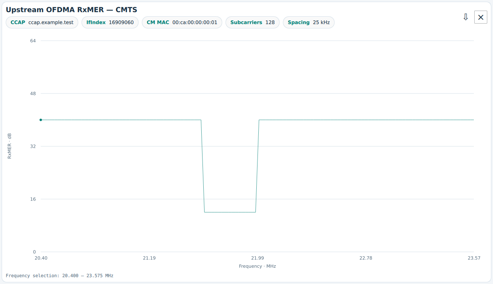

# Upstream OFDMA RxMER — CMTS

[Measurements](../../measurements.md) · [Wire contract](../../../reference/cmts-upstream-rxmer/format.md) · [Python API](../../../../bindings/python/README.md)

Choose **Open**, or drop a file into the main workspace. RAVEN identifies its
contents as **Upstream OFDMA RxMER — CMTS** and displays MER in dB versus
frequency in MHz. CCAP identity, upstream ifIndex, target modem and spacing are
kept separate from downstream channel metadata.

Drag across the chart to zoom and double-click to reset. Hover to inspect the
frequency and MER. Unavailable carriers remain gaps, including their original
frequency positions. Export JSON for every original sample, raw octet, carrier
index, frequency and validity status. Reports uses the existing offline native
report view and a prepared upstream question; no provider is contacted.

The first release supports single captures in PNN major 2 format. Downstream
Modulation & Capacity and collection playback/Min-Avg-Max do not accept these
upstream measurements. Unknown header versions and legacy PNM layouts report
structured errors. Header format version is not a DOCSIS generation indicator.

## Synthetic examples

Use `tests/fixtures/synthetic/cmts-upstream-rxmer/`: uniform, localized notch,
frequency slope, sparse unavailable values and all-unavailable captures. These
are specification-derived synthetic files, not lab/field captures. A binary alone
does not carry synthetic provenance; retain its adjacent manifest.

For a nominal example, open `mer-36db-sd-0p75db.bin`: 1,024 carriers with
mean MER **36 dB** and population standard deviation **0.75 dB** across the
encoded readings. The quarter-dB values follow a shuffled symmetric normal-like
histogram, with a 33.5–38.5 dB range. Frequencies span 20.400–45.975 MHz at
25 kHz spacing. This is variation in carrier MER, not an I/Q noise simulation.

The generator is Rust and writes a new directory under this checkout's `local/`
only. Its parent must already exist; existing output directories are refused:

```bash
./scripts/cargo-local.sh run -p pnm --example cmts_rxmer_fixtures --locked -- \
  local/new-cmts-rxmer-examples
```

Every binary has expected values or a named error in its JSON manifest. Invalid
fixtures intentionally fail and must not be used as successful capture examples.
The historical legacy layout and newer CCAP revisions still require evidence.

## Chart examples

The same synthetic notch capture is shown in both themes. The 12 dB section
is surrounded by 40 dB carriers. These images are native Qt screenshots.

<picture>
  <source media="(prefers-color-scheme: dark)" srcset="images/cmts-upstream-rxmer-dark.png">
  
</picture>
