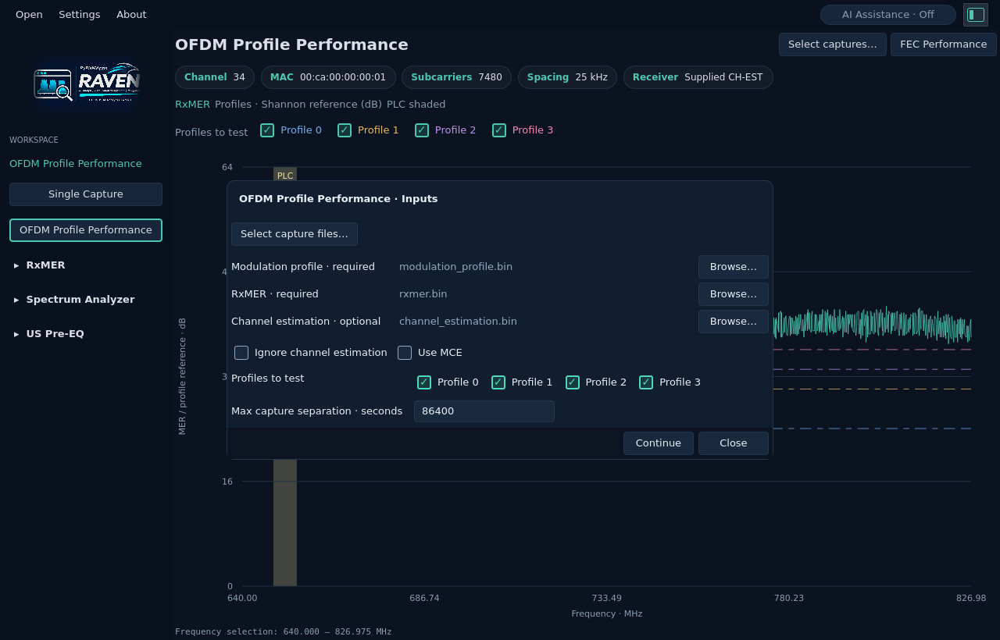
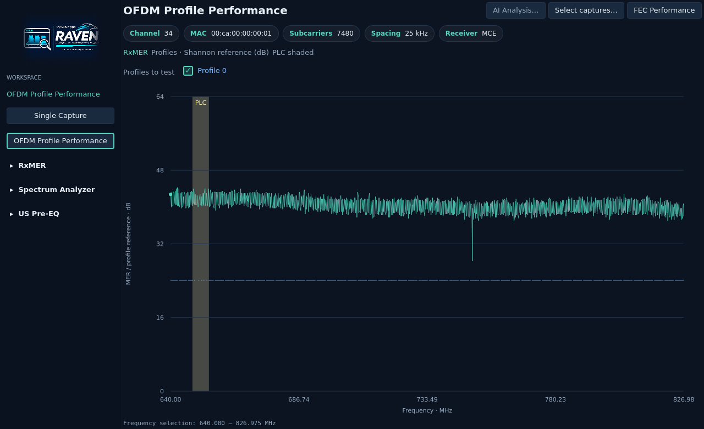
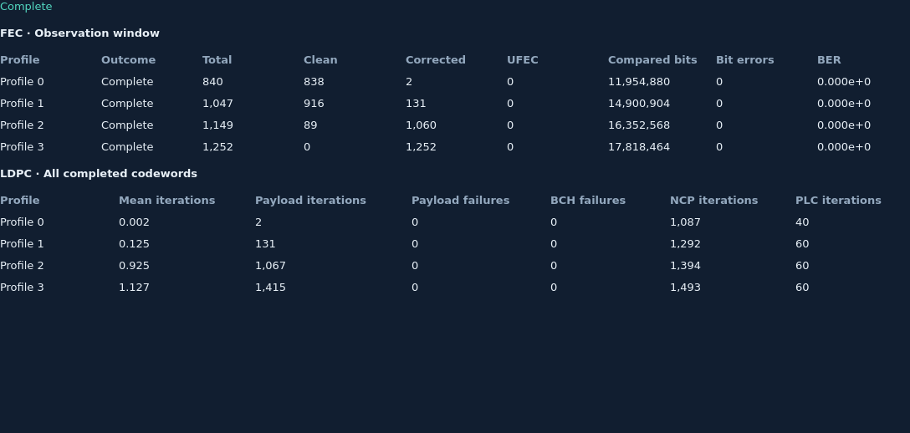

# OFDM Profile Performance

[User guide](../../README.md) · [Technical design](../../../development/ofdm-profile-performance.md)

Use **OFDM Profile Performance** in the left navigation to test a captured
modulation profile against measured RxMER, with optional channel estimation.
This is a decoder simulation rather than counters collected from your modem.

1. Click **Select captures…** (the input popup opens on first use).
2. Click **Select capture files…** and select the modulation-profile and RxMER
   captures together, plus optional downstream channel estimation. Use Ctrl or
   Command to select multiple files in the operating system's file picker.
   The app identifies each capture by its contents, regardless of filename or order,
   and checks compatibility using the capture-separation setting before loading.
   Duplicate types, missing required inputs and incompatible files leave the current
   selection unchanged. Selecting only the required pair clears any previous channel.
   Individual **Browse…** buttons remain available to replace one input.
3. With channel estimation selected, enable **Use MCE**
   to estimate receiver correction from received pilots. Leave it off to use the
   supplied correction. Toggle **Ignore channel estimation** to use a unity channel
   without removing the selected file. MCE is disabled while the channel is ignored;
   untoggle Ignore to use the attached capture again. Without a channel file, the
   simulation also uses a unity channel.
4. Check the captured profiles to test (all are initially checked), and set the
   maximum capture separation in seconds.
   The default is one day; enter zero to require matching profile/RxMER timestamps.
5. Click **Continue**. The MAC address, channel and frequency grids must match.
   A bad input opens an error popup and leaves the input popup available to fix it.

The bundled **files → demo → ofdm-profile-performance** folder contains
`modulation_profile.bin`, `rxmer.bin`, `channel_estimation.bin` and a walkthrough.
Use these together with the default time tolerance. See the
[installed demo locations](../../examples.md#ofdm-profile-performance).
Close dismisses input selection without running a simulation. File selection does
not modify captures. This popup currently accepts binary PNM captures.

The main graph overlays measured RxMER and the checked profiles' **Shannon
references (dB)**. That reference shows the ideal relationship to modulation size;
it is not a guaranteed FEC threshold. PLC carriers are labeled **PLC** inside their band, with pale-yellow shading in dark mode and a warmer amber-yellow
shade in light mode to stand out against the white graph. Drag a section of
the plot to zoom and double-click to restore the full frequency range.

Use the workspace's **Profiles to test** checkboxes to choose any combination of
prepared profiles. Each checkbox controls that profile's overlay and inclusion in
the next test. Clearing every box disables FEC Performance; selecting a box enables
it again. Changing the selection clears previous results. To include a profile
that was not prepared, reopen Select captures and check it before Continue.

Choose **FEC Performance** to run all checked profiles sequentially. The popup
keeps separate FEC and LDPC table rows for each profile; it does not pool their
counters or BER. It displays:

- FEC codeword counts, compared bits, bit errors and BER for the observation window.
- LDPC mean and total iterations, failures, and NCP/PLC iterations for all completed
  codewords, including completion/drain. BCH failures use this same completed scope.
- The actual run status, including cancellation or runtime limits. A dash means
  unavailable; it does not mean zero errors.

The current observation is 10 ms per profile, with a 300-second host limit per
profile. A multi-profile run may take longer because it simulates
transmission, acquisition and decoding. **Stop** requests cancellation. Closing
the results popup leaves the run active; reopen it with FEC Performance after
completion or select Run again in the popup for a new run of all checked profiles. Change inputs through
Select captures and Continue before testing a different profile or receiver mode.

## Select captures together

<picture>
  <source media="(prefers-color-scheme: dark)" srcset="images/ofdm-inputs-dark.png">
  <source media="(prefers-color-scheme: light)" srcset="images/ofdm-inputs-light.png">
  
</picture>

## Workspace

<picture>
  <source media="(prefers-color-scheme: dark)" srcset="images/ofdm-profile-dark.png">
  <source media="(prefers-color-scheme: light)" srcset="images/ofdm-profile-light.png">
  
</picture>

## FEC and LDPC results

<picture>
  <source media="(prefers-color-scheme: dark)" srcset="images/ofdm-profile-fec-dark.png">
  <source media="(prefers-color-scheme: light)" srcset="images/ofdm-profile-fec-light.png">
  
</picture>

Screenshots show the actual Ubuntu Qt workspace and results content, using the
bundled single captures and Profiles 0–3 with MCE. They are not modem measurements
of FEC counters or independent Windows/macOS runtime evidence.

## AI review

After a run, use **AI Analysis…** to ask about the outcomes. Preview the exact
request and approve it before sending. See [AI Assistance](../../ai-assistance.md)
for OpenAI setup, model testing, evidence limits and conversation export.
